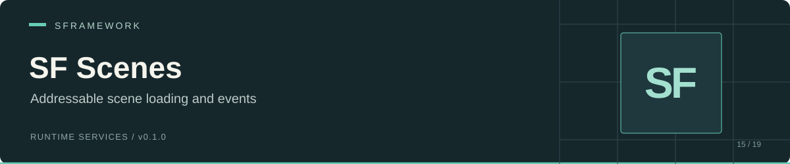

# SF Scenes

 

SF Scenes maps config IDs to Addressables scene keys, loads scenes additively, and exposes load/unload events through `ISFScenesService`. It can recognize scenes that Unity already loaded and associate them with a configured ID.

Use it for a persistent startup scene with additive levels, scene switching by config ID, or controllers that need loading-state notifications.

[Install](#install) · [Configure](#configure) · [Use](#use) · [API](#api) · [Limitations](#limitations)

## Install

In Unity Package Manager, select **Add package from git URL** and enter:

```text
https://github.com/huran438/sf-scenes.git#main
```

The [manifest](package.json) declares no dependencies. Install these separately:

| Requirement | Reason |
| --- | --- |
| [SF Core](https://github.com/huran438/sf-core) | Service registration and initialization. |
| [SF Configs](https://github.com/huran438/sf-configs) | Scene config loading and ID tree. |
| [SF Debug](https://github.com/huran438/sf-debug) | Assembly dependency of SF Core. |
| [UniTask](https://github.com/Cysharp/UniTask) | Async service and scene methods. Include the `UniTask.Addressables` assembly. |
| Unity Addressables (`com.unity.addressables`) | SceneInstance, Addressables scene loading, and ResourceManager assemblies. |
| Newtonsoft.Json | SF Configs references `Newtonsoft.Json.dll`. |

Your code assembly must reference `SFramework.Scenes.Runtime` and the SF assemblies it uses. The [runtime assembly definition](Runtime/SFramework.Scenes.Runtime.asmdef) explicitly references `UniTask.Addressables`.

`package.json` lists Unity `2019.4`; the source and SF Core use newer C# and Unity APIs. That value is package metadata. No supported editor floor was verified here.

## Configure

Save this as a JSON TextAsset under a `Resources` folder, for example `Assets/Resources/SFramework/Scenes.json`:

```json
{
  "Type": "SFScenesConfig",
  "Id": "scenes",
  "Version": 1,
  "Groups": [{
    "Id": "levels",
    "Scenes": [{
      "Id": "arena",
      "Path": "Scenes/Arena"
    }]
  }]
}
```

Keep `Type` first because SF Configs identifies JSON by its first or last property. Mark the scene Addressable with the address `Scenes/Arena`. The configured service ID is `scenes/levels/arena`, built from config, group, and scene IDs.

| Type / field | Purpose |
| --- | --- |
| `SFScenesConfig.Groups` | Top-level scene groups. |
| `SFScenesGroupContainer.Scenes` | Scene nodes in each group. |
| `SFSceneNode.Path` | Addressables key passed to scene loading. |
| `SFSceneAttribute` | Inspector ID selector for `SFScenesConfig`; its namespace is `SFramework.UI.Runtime`. |

Register configs before scenes. SF Core constructs services during `Bind`, then awaits service initialization in registration order. The current scene service reads only the first `SFScenesConfig`; use one scene config and initialize its group/scene arrays.

## Use

Save this class as `ScenesContext.cs` and add it to your startup scene. For this example, the default SF Configs service must load only `SFScenesConfig` JSON; see the mixed-config limitation below.

```csharp
using System.Threading;
using Cysharp.Threading.Tasks;
using SFramework.Configs.Runtime;
using SFramework.Core.Runtime;
using SFramework.Scenes.Runtime;
using UnityEngine;

public sealed class ScenesContext : SFContextRoot
{
    private ISFScenesService _scenes;

    protected override void PreInit() { }

    protected override void Bind()
    {
        SFContainer.Register<ISFConfigsService, SFConfigsService>();
        _scenes = SFContainer.Register<ISFScenesService, SFScenesService>();
    }

    protected override async UniTask Init(CancellationToken cancellationToken)
    {
        const string id = "scenes/levels/arena";
        await _scenes.LoadScene(id, setActive: true);
        if (_scenes.IsLoaded(id))
            Debug.Log("Arena is loaded.");
    }

    public async UniTask LeaveArena()
    {
        await _scenes.UnloadScene("scenes/levels/arena");
    }
}
```

`setActive` changes Unity's active scene after a successful load; it does not unload other scenes. Load or retain your next scene before unloading the current one. Await `context.WaitForInitialization()` before another controller uses the service.

The service recognizes an already loaded scene by configured path or filename. In the Editor, it also resolves the Addressables key and compares resource locations with loaded scenes. For that external-scene path, `LoadScene` returns a default `SceneInstance` despite successful registration. Use `IsLoaded(id)` and unload by ID when the scene might have loaded outside this service.

```mermaid
sequenceDiagram
    participant Caller
    participant Service as SFScenesService
    participant Addressables
    Caller->>Service: LoadScene(id, setActive)
    Service-->>Caller: OnSceneLoad(id)
    Service->>Addressables: LoadSceneAsync(key, Additive)
    Addressables-->>Service: SceneInstance
    Service->>Service: Track instance; optionally set active
    Service-->>Caller: OnSceneLoaded(id)
    Service-->>Caller: SceneInstance
```

This sequence describes a new Addressables load. An already tracked scene returns without emitting load events; an external scene emits both events without a new Addressables load.

## API

The [interface](Runtime/ISFScenesService.cs) extends `ISFService`, including `UniTask Init(CancellationToken cancellationToken)` and `void Dispose()`.

| Signature | Behavior |
| --- | --- |
| `bool IsLoading(string sfScene)` | Checks the operation list for this ID; includes unloading. |
| `bool IsLoading()` | Checks whether the operation list contains any IDs. |
| `bool IsLoaded(string sfScene)` | Checks tracked Addressables scenes or valid external scenes. |
| `bool TryGetScenePath(string sfScene, out string path)` | Looks up the configured key. |
| `bool GetActiveScene(out string sfScene)` | Resolves the active scene to an ID, including recognized external scenes. |
| `bool GetActiveScene(out SceneInstance sceneInstance)` | Resolves only tracked Addressables scenes. |
| `SceneInstance GetScene(string sfScene)` | Returns a tracked instance or a default value. |
| `UniTask<SceneInstance> LoadScene(string sfScene, bool setActive)` | Loads additively, returns the tracked instance, or recognizes an external scene. Unknown IDs return default. |
| `UniTask UnloadScene(string sfScene)` | Unloads tracked or recognized external scenes by ID. |
| `UniTask UnloadScene(SceneInstance sceneInstance)` | Unloads an instance; untracked instances do not emit the service's ID events. |
| `UniTask<SceneInstance> ReloadScene(string sfScene)` | Unloads and reloads a tracked Addressables scene, preserving whether it was active. External or unknown scenes return default. |

Use an explicit out type to choose between the active-scene overloads:

```csharp
using SFramework.Scenes.Runtime;

public static class ActiveSceneId
{
    public static string Read(ISFScenesService scenes)
    {
        return scenes.GetActiveScene(out string id) ? id : string.Empty;
    }
}
```

All four events use `Action<string>` with the configured scene ID: `OnSceneLoad`, `OnSceneLoaded`, `OnSceneUnload`, and `OnSceneUnloaded`. Subscribe before the operation you want to observe, and unsubscribe when your controller ends its lifetime.

## Limitations

- `Init` calls the obsolete `GetConfigs<SFScenesConfig>()`. Current SF Configs casts the entire config collection instead of filtering it, so other JSON config types can cause `InvalidCastException`. Supply a type-filtering `ISFConfigsService` implementation or address that integration issue before combining config modules. A missing scene config causes a null dereference in initialization.
- The service exposes no progress or cancellation parameter for scene operations. It ignores the initialization token. Failed operations have no `try/finally` cleanup, so an exception can leave `IsLoading()` true.
- `IsLoading` reports state; it does not block duplicate operations. Coordinate concurrent loads, unloads, and reloads for the same ID in your application.
- External-scene recognition can match by filename. Distinct scenes with the same filename can produce an unintended match; use distinct names and verify the configured keys.
- `GetScene` and the `SceneInstance` active-scene overload exclude external scenes. `ReloadScene` also excludes them. Unload an external scene by ID and call `LoadScene` again if you need to reload it.
- `Dispose()` does not unload scenes or clear tracking dictionaries. SF Scenes does not run component injection after loading; `SFView` supplies its own injection in `Awake` through SF Core.

If loading returns default, check `TryGetScenePath` and `IsLoaded` to distinguish an unknown ID from a recognized external scene. For a stale loading flag after an exception, inspect the failed Addressables operation before issuing another request.

## Source and related modules

[Service](Runtime/SFScenesService.cs) · [Config](Runtime/SFScenesConfig.cs) · [Scene node](Runtime/SFSceneNode.cs) · [ID attribute](Runtime/SFSceneAttribute.cs)

[SF Core](https://github.com/huran438/sf-core) provides service initialization; [SF Configs](https://github.com/huran438/sf-configs) loads JSON; [SF UI](https://github.com/huran438/sf-ui) manages screens that can accompany a scene change.

Documentation reflects source snapshot `58d327f8add46e878039b4d95e4be61e597857c0`. API and dependency checks were static; no Unity compile, scene transition run, player build, or Addressables build was performed.

## License

MIT. See [LICENSE.md](LICENSE.md) for the terms.
